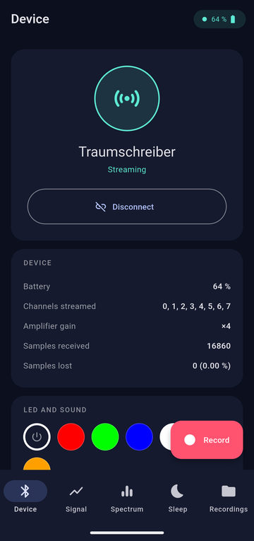
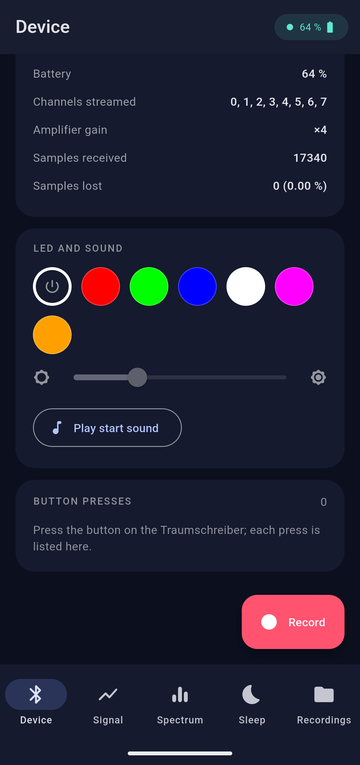
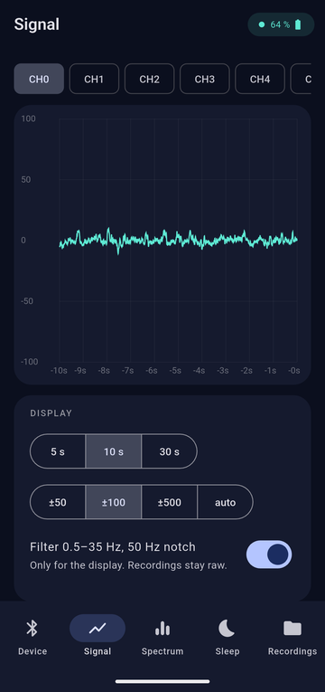
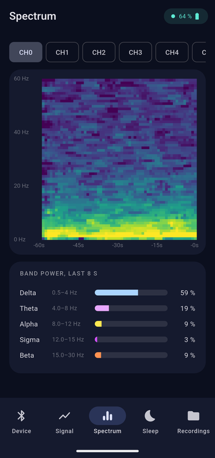
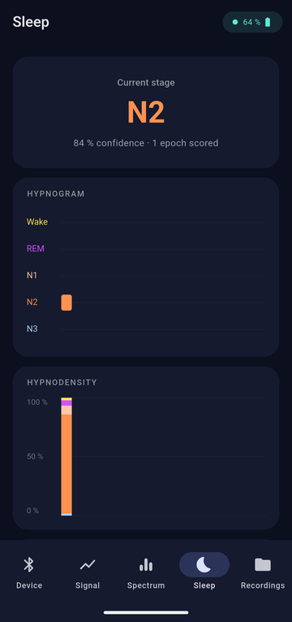

# Traumschreiber — minimal Flutter app

**A small, readable Android app that streams EEG from the
[Traumschreiber](https://github.com/sd20-org/traumschreiber)
headband over Bluetooth, shows it live, analyses it and records it. Written to be read and
copied from: if you want your own app for the Traumschreiber, start here.**

| Device | LED, sound, button | Live signal | Spectrogram | Sleep stages |
|:---:|:---:|:---:|:---:|:---:|
|  |  |  |  |  |

## What the app does

| Page | What you see and can do |
|---|---|
| **Device** | Connect and disconnect, battery level, how many samples arrived or were lost. Set the colour of the device's LED, play its start sound, and see every press of its button with date and time. **Record** starts and stops saving to a file. |
| **Signal** | One of the eight EEG channels in real time, filtered 0.5–35 Hz with a 50 Hz notch, over the last 5, 10 or 30 seconds. |
| **Spectrum** | Spectrogram of the last 60 seconds from 0 to 60 Hz (one column per second, smoothed with a 5-second median), and how the power splits into the delta, theta, alpha, sigma and beta bands. |
| **Sleep** | The current sleep stage, the hypnogram and the hypnodensity (how sure the model is about each stage), scored every 30 seconds by the open-source model [AnySleep](https://github.com/dslaborg/AnySleep). |
| **Recordings** | Your saved recordings. Share them (e-mail, cloud, another app) or delete them. |

Streaming starts as soon as the device is connected; recording to a file is a separate step.
A recording is a CSV file with all eight channels in microvolts. The sleep stages and button
presses of that time are saved in two small files next to it.

The whole app is about 2,000 lines of Dart. For whole nights recorded on the device's microSD
card, use the companion repository
[Traumschreiber_Python_Offline-Data-Analysis](https://github.com/sd20-org/Traumschreiber_Python_Offline-Data-Analysis).

> The Traumschreiber is **not a medical device**, and neither is this app. It is meant for
> education, research and self-observation, not for diagnosing anything.

## Try it

**You need**

- a Traumschreiber (TS2607 or later),
- an Android phone with Bluetooth, Android 7 or newer, with
  [USB debugging switched on](https://developer.android.com/studio/debug/dev-options),
- a computer with [Flutter](https://docs.flutter.dev/get-started/install) 3.38 or newer
  (the installation guide also sets up the Android tools).

**Steps**

```bash
git clone https://github.com/sd20-org/Traumschreiber_Flutter_Minimal-App.git
cd Traumschreiber_Flutter_Minimal-App
flutter pub get
flutter run          # with the phone connected by USB
```

Then switch the Traumschreiber on, tap **Connect** in the app and allow access to nearby
devices. The signal appears within a few seconds; the first sleep stage after one minute.

The sleep model (13 MB) is downloaded once, on the first connection. To build an app that
works without internet, bundle the model first:

```bash
tool/fetch_model.sh
flutter build apk    # the APK is in build/app/outputs/flutter-apk/
```

iOS should work as well but has not been tested.

**If something does not work**

| Problem | What to do |
|---|---|
| "No Traumschreiber found" | Switch the device on and keep it close. It connects to one phone at a time: close other apps that may be connected to it, such as the sd20 app. |
| The signal is a flat line or jumps wildly | Check that the electrodes touch the skin. A large offset right after putting them on settles within a minute. |
| "Model download failed" | The phone needs internet once for the sleep model, or bundle it with `tool/fetch_model.sh`. |
| Samples lost | Keep the phone within a few metres; walls and bodies weaken Bluetooth. |

## How the code works

Read it in this order; each file starts with a short explanation.

```
lib/
├── traumschreiber/traumschreiber.dart   Bluetooth: find, connect, start the stream, decode packets
├── app_state.dart                       hands every block of samples to plot, spectrum, sleep, recorder
├── analysis/
│   ├── spectrum.dart                    power spectrum (Welch) with a small FFT
│   ├── sleep_staging.dart               30-second epochs → AnySleep on a background isolate
│   └── dsp_filters.dart                 the model's preprocessing, identical to the Python script
├── recording/recorder.dart              CSV files: write, list, share
└── ui/                                  one file per page
```

The data flows in one direction:

```
Traumschreiber ──Bluetooth──▶ traumschreiber.dart ──samples──▶ app_state.dart ──▶ live plot
                                                                             ├──▶ spectrogram
                                                                             ├──▶ sleep staging
                                                                             └──▶ CSV recorder
```

### The Bluetooth protocol

| Service / characteristic | UUID | Use |
|---|---|---|
| ADS service | `0483ddda-6c9d-6ca9-5d41-03ad4fff4abb` | EEG |
| ↳ Data (notify) | `0483dddb-…` | sample packets, see below |
| ↳ Control (write) | `0483dddc-…` | `0x01` start streaming, `0x02` stop |
| ↳ Status (read) | `0483dddd-…` | streamed channels, gain, sample counter |
| Battery service | `0x180F` / level `0x2A19` | one byte, percent |
| LED/button service | `00001523-1212-efde-1523-785feabcd123` | |
| ↳ Button (notify) | `00001524-…` | `1` pressed, `0` released |
| ↳ RGB LED (write) | `00001526-…` | three bytes `[R, G, B]`, 0–255 |
| ↳ Play file (write) | `00001529-…` | path of a WAV under `SOUNDS/`, e.g. `SOUNDS/TSBOOT.WAV` (the start sound) |
| ↳ Playback state (notify) | `0000152b-…` | `0` stopped, `1` playing, `3` error |

The device advertises the name `Traumschreiber`. After connecting: request an MTU of 512,
read the status, subscribe to the Data characteristic, then write `0x01`.

**Data packet:** one header byte `0xC0`, then any number of samples, each
`4 + 8 + 3·n + 4` bytes for `n` streamed channels (normally 8):

| Bytes | Field |
|---|---|
| 4 | sample number, uint32 little endian, +1 per sample |
| 8 | device time in µs, uint64 |
| 3 × n | channel values, signed 24-bit little endian |
| 4 | status word |

To microvolts: `µV = value × 1.2e6 / gain / 2^23`. The sample rate is 250 Hz.
A packet with only the byte `0xC0` is a keep-alive. A gap in the sample numbers means
samples were lost in transmission (the device still has them on its SD card).

All of this is in [`decodePacket`](lib/traumschreiber/traumschreiber.dart) and
[`DeviceStatus.parse`](lib/traumschreiber/traumschreiber.dart), both covered by tests
(`flutter test`).

### Sleep staging

Every 30 seconds, the newest epoch is scored together with up to 19 earlier ones for context,
the way a human scorer looks at the neighbours. The preprocessing (50 Hz notch, 0.3–35 Hz band
pass, resampling to 128 Hz, robust scaling) is identical to the Python script, so both give the
same stages for the same data. The ONNX model was exported from the AnySleep weights with
[`tool/export_anysleep_onnx.py`](tool/export_anysleep_onnx.py) so that it accepts any length.

Use a channel on the forehead referenced to the mastoid if you have one; the model was trained
on clinical EEG.

### The recording files

```
# Traumschreiber recording
# device: Traumschreiber
# started: 2026-11-01T22:14:03.000
# sample_rate_hz: 250
# unit: microvolt
sample_number,time_s,ch0,ch1,ch2,ch3,ch4,ch5,ch6,ch7
1734501,0.000,-12.41,3.08,…
```

Values are raw, not filtered. `time_s` comes from the sample number, so it is exact even if
packets arrive late. Next to it, `…_stages.csv` holds one line per 30-second epoch (stage and
the five probabilities) and `…_button.csv` the time of every button press.

Open a recording in Python:

```python
import pandas as pd
eeg = pd.read_csv("TS_20261101_221403.csv", comment="#")
eeg.plot(x="time_s", y="ch0")
```

## Ideas for your own version

- Several devices at once: `_scan()` takes the first one it finds; collect them in a list instead.
- Reconnect automatically after the link drops, and fill the gap from the SD card (the
  sd20 app does both).
- Record in the background with the screen off (needs an Android foreground service).
- Other analyses: eye movements, alpha with eyes closed, heart rate from a chest channel.

## Licence

MIT, see [LICENSE](LICENSE). AnySleep is by its authors, also under the MIT licence:
[github.com/dslaborg/AnySleep](https://github.com/dslaborg/AnySleep).

Made by the [Institute of Sleep and Dream Technologies](https://sd20.org).
